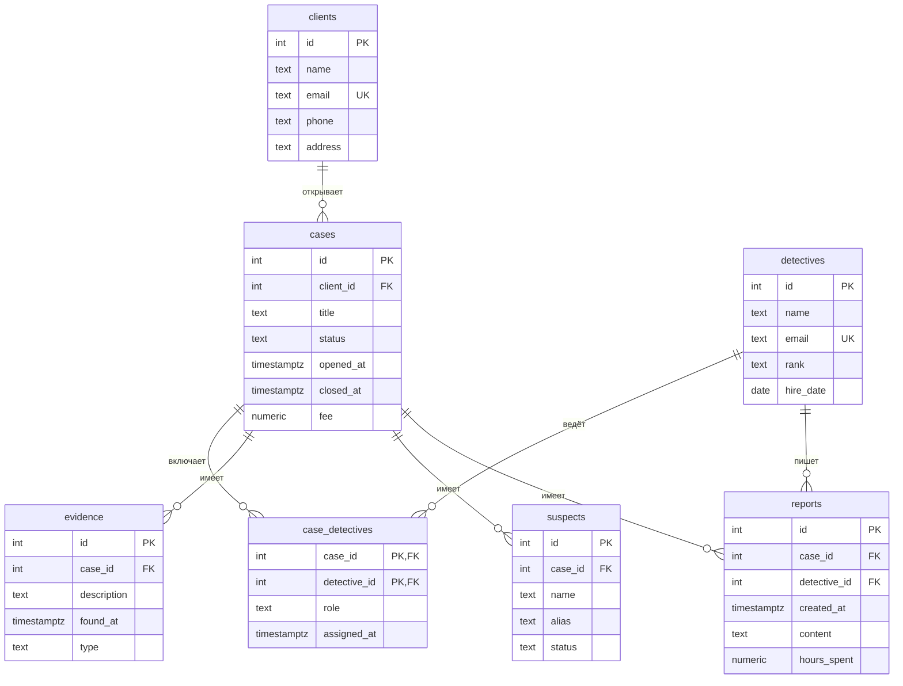

# Детективное агентство

Тема: **Детективное агентство**. База хранит данные о клиентах, детективах, делах, уликах, подозреваемых и отчётах, чтобы вести учёт работы частного агентства от обращения клиента до закрытия дела.

| | |
| --- | --- |
| Главная таблица | `cases` |
| Связь N:M | `cases` и `detectives` через `case_detectives` |
| Бизнес-правило | гонорар больше нуля; дата закрытия позже даты открытия; нельзя удалить клиента или детектива, пока на них есть ссылки |
| СУБД | PostgreSQL 17 в Docker |

## Задания курса

Правила курса, установка и порядок сдачи: [docs/README.md](docs/README.md).

| Лаба | Задание |
| --- | --- |
| 1. Модель данных и схема | [docs/lab-1.md](docs/lab-1.md) |
| 2. Запросы | [docs/lab-2.md](docs/lab-2.md) |
| 3. Логика в базе | [docs/lab-3.md](docs/lab-3.md) |
| 4. Транзакции и доступ | [docs/lab-4.md](docs/lab-4.md) |
| 5. Производительность | [docs/lab-5.md](docs/lab-5.md) |
| Витрина к защите | [docs/showcase.md](docs/showcase.md) |

## Как запустить

```bash
cp .env.example .env          # пароли и порт
docker compose up -d          # при первом запуске выполняются скрипты из db/
dbcheck run demo/lab1.sql     # сценарий лабы 1
```

Работа с базой: `docker compose exec db psql -U postgres -d app`. Сценарии выполняются в `psql` командой `\i /demo/lab1.sql`.

После изменения скриптов в `db/` базу нужно пересоздать: `docker compose down -v && docker compose up -d`.

## ER-диаграмма



## Ограничения

| Ограничение | Таблица и колонки | Зачем |
| --- | --- | --- |
| `UNIQUE` | `clients.email` | один email — один клиент |
| `UNIQUE` | `detectives.email` | один email — один детектив |
| `UNIQUE` (составной) | `case_detectives (case_id, detective_id)` | нельзя назначить одного детектива на одно дело дважды |
| `CHECK` | `cases.status IN ('open','closed','suspended')` | только допустимые статусы дела |
| `CHECK` | `cases.fee >= 0` | гонорар не может быть отрицательным |
| `CHECK` | `reports.hours_spent > 0` | часы положительные |
| `CHECK` | `closed_at IS NULL OR closed_at > opened_at` | дата закрытия позже даты открытия |
| `FOREIGN KEY` | все поля вида `*_id` | защита от ссылок на несуществующие строки |

## Что сделано по лабам

| Лаба | Что сделано | Сценарий |
| --- | --- | --- |
| 1 | 7 таблиц, связь N:M через `case_detectives`, ограничения, seed на 10+ строк, генерация 1000 улик | `demo/lab1.sql` |
| 2 | — | `demo/lab2.sql` |
| 3 | — | `demo/lab3.sql` |
| 4 | — | `demo/lab4.sql`, `demo/race.sql`, `demo/race_fixed.sql` |
| 5 | — | `demo/lab5.sql` |

## Нормализация

Исходная «плоская» таблица `cases_flat`, где всё хранится в одном месте:

| case_title | client_name | client_email | detective_name | evidence_desc | suspect_name | fee |
|------------|-------------|--------------|----------------|---------------|--------------|-----|
| Пропажа реликвии | Иван Петров | ivan@example.com | Шерлок Холмс | Отпечатки | Николай Иванов | 50000 |
| Пропажа реликвии | Иван Петров | ivan@example.com | Джон Ватсон | Запись с камеры | Светлана Петрова | 50000 |
| Слежка за супругом | Мария Сидорова | maria@example.com | Эркюль Пуаро | Фотографии | Олег Смирнов | 30000 |

**Проблемы:**
- Данные клиента (имя, email) повторяются в каждом его деле.
- Данные детектива повторяются в каждом деле и отчёте.
- Улики и подозреваемые дублируют информацию о деле.
- При переезде клиента нужно менять много строк, легко где-то забыть.

**Разбиение до 3НФ:**
1. `clients` — клиенты.
2. `detectives` — детективы.
3. `cases` — дела (ссылка на клиента).
4. `case_detectives` — связь N:M между делами и детективами.
5. `evidence` — улики по делу.
6. `suspects` — подозреваемые по делу.
7. `reports` — отчёты детективов.

Теперь каждый факт хранится в одном месте, дублирование устранено.

**1НФ**: в каждой ячейке одно значение, без списков через запятую.  
**2НФ**: каждый неключевой столбец зависит от всего ключа, а не от его части.  
**3НФ**: неключевые столбцы не зависят друг от друга.

## Типы данных

- **Деньги** — `numeric(10,2)` для `cases.fee` и `numeric(5,2)` для `reports.hours_spent`. Float хранит числа приближённо (`0.1 + 0.2 ≠ 0.3`), для денег нужна точность.
- **Время** — `timestamptz` для `opened_at`, `closed_at`, `assigned_at`, `found_at`, `created_at`. Учитывает часовой пояс.
- **Статусы** — через `CHECK (status IN (...))`: только допустимые значения, без справочной таблицы.

## Что происходит при удалении

| Связь | ON DELETE | Причина |
|-------|-----------|---------|
| `cases.client_id → clients.id` | `RESTRICT` | нельзя удалить клиента, пока у него есть дела |
| `case_detectives.case_id → cases.id` | `CASCADE` | при удалении дела назначения теряют смысл |
| `case_detectives.detective_id → detectives.id` | `RESTRICT` | нельзя удалить детектива, пока он ведёт дела |
| `evidence.case_id → cases.id` | `CASCADE` | улики без дела не нужны |
| `suspects.case_id → cases.id` | `CASCADE` | подозреваемые без дела не нужны |
| `reports.case_id → cases.id` | `CASCADE` | отчёты без дела не нужны |
| `reports.detective_id → detectives.id` | `RESTRICT` | нельзя удалить детектива, если есть его отчёты |